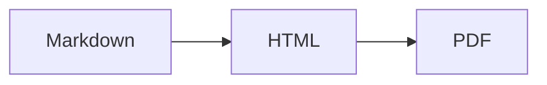

# 範例文件 Sample

這是一段**粗體**、*斜體*、~~刪除線~~ 與 `inline code` 的中文段落。自動連結：https://github.com :rocket:


## 目錄

- [表格](#表格)
- [程式碼](#程式碼)

## 表格

| 項目 | 數量 | 說明 |
|:-----|-----:|:----:|
| 蘋果 | 3 | 紅色 |
| 香蕉 | 12 | 黃色 |

## 程式碼

```python
def hello(name: str) -> str:
    return f"Hello, {name}!"  # 一行很長的註解用來測試自動換行，避免在 PDF 中被裁切掉而遺失內容，這行應該會自動折行顯示完整內容
```

## 清單

- [x] 已完成
- [ ] 未完成
  1. 巢狀
  2. 編號

> [!NOTE]
> GitHub 風格提示框。

> 一般引用

## 數學

行內 $E = mc^2$，區塊：

$$
\int_0^1 x^2\,dx = \frac{1}{3}
$$

## 圖表



註腳[^1]。

[^1]: 這是註腳內容。
